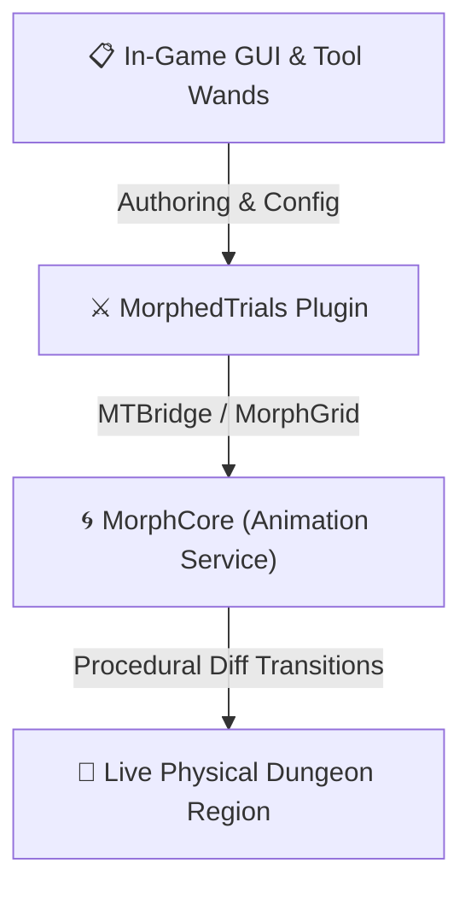

# ⚔️ MorphedTrials

> **Party-Based Procedural Mob Dungeons on Single Self-Morphing Arenas for Paper 1.21+**  
> *Seamlessly transform physical dungeon rooms floor-by-floor as adventuring parties progress, powered by [MorphCore](https://github.com/scrunc/morphcore).*

---

## 🌟 Overview

**MorphedTrials** is an innovative dungeon crawler plugin for Minecraft (Paper 1.21+) that enables multi-level, rogue-like party trials within a **single physical cuboid region**.

Traditional dungeon plugins require duplicating vast world coordinates or managing multiple worlds to stage different dungeon floors. **MorphedTrials eliminates world bloat entirely** by capturing multiple layout states (levels) inside one shared bounding box. When a party defeats a room's hostile mobs and activates the exit portal, the room procedurally reshapes itself in real-time around the players into the next floor using diff-only block transitions.

---

## 🚀 Key Features

### 🏰 Single-Region Multi-Floor Architecture
* **Zero World Clutter:** Dungeons reside within one shared bounding box.
* **Procedural Floor Swapping:** Transitions from Floor 1 to Floor 2, 3, etc. happen live in front of the players.
* **Safe-Landing Guarantees:** Start pads feature immediate structure force-placement within a configurable radius to prevent players from suffocating or falling during active morph animations.
* **Automatic Idle Reset:** When a run completes or disbands, the region smoothly animates back to its resting state for the next group.

### 👥 Party & Queue Progression
* **Lobby System:** Players queue using `/mtrials join <dungeon>`.
* **Configurable Countdown:** Once the required minimum players queue, an automated countdown begins and transports the party together.
* **Shared Combat State:** Mob spawns and kill goals are tracked across the party in real time.
* **Headcount End-Pads:** To advance, the level must be completely cleared of mobs and at least 50% of the active party must stand on the designated End Pad simultaneously.

### 🎨 In-Game GUI & Wand Workflow
* **Visual Authoring:** Full interactive GUI navigation via `/mtrials gui` (Dungeon List ➔ Overview ➔ Level Editor ➔ Style Picker).
* **Collision-Free Wands:** Non-conflicting tool bindings that never overlap with GriefPrevention (`GOLDEN_SHOVEL`, `STICK`) or WorldEdit (`WOODEN_AXE`):
  * 🟪 **Region Wand** (`NETHERITE_SHOVEL`): Defines the master bounding box for the entire dungeon.
  * 🟦 **Start Wand** (`DIAMOND_HOE`): Defines the player spawn and safe-landing landing pad.
  * 🟨 **End Wand** (`IRON_HOE`): Defines the completion exit pad.
* **Live Particle Highlighting:** Active edit sessions render distinct particle boundaries around the dungeon perimeter and pads in real-time.

---

## 🏛 Ecosystem & Architecture



### MorphCore Integration
MorphedTrials utilizes `MTBridge.java` to safely integrate with `MorphCore` via Bukkit's `ServicesManager`. If `MorphCore` is absent, the plugin gracefully falls back to instant block switching without breaking or throwing `NoClassDefFoundError`.

---

## 📜 Commands & Permissions

### Commands
| Command | Permission | Description |
| :--- | :--- | :--- |
| `/mtrials gui` | `morphedtrials.admin` | Opens the master dungeon management GUI |
| `/mtrials wand <region\|start\|end>` | `morphedtrials.admin` | Gives the selected authoring wand tool |
| `/mtrials join <dungeon>` | `morphedtrials.use` | Queues player for a dungeon party run |
| `/mtrials leave [player]` | `morphedtrials.use` | Leaves current queue or ongoing trial |
| `/mtrials dungeon create <name>` | `morphedtrials.admin` | Creates a new dungeon container |
| `/mtrials dungeon delete <name>` | `morphedtrials.admin` | Deletes a dungeon |
| `/mtrials dungeon list` | `morphedtrials.admin` | Lists all configured dungeons |
| `/mtrials dungeon <name> setregion` | `morphedtrials.admin` | Applies Region Wand selection to dungeon |
| `/mtrials dungeon <name> forcestart` | `morphedtrials.admin` | Skips queue countdown and starts trial immediately |
| `/mtrials dungeon <name> reward add <cmd>` | `morphedtrials.admin` | Adds completion reward command (`%player%` placeholder) |
| `/mtrials edit <subcommand>` | `morphedtrials.admin` | Context-sensitive level editing commands |
| `/mtrials reload` | `morphedtrials.admin` | Reloads configuration files from disk |

### Permissions
* `morphedtrials.admin` *(Default: op)* — Full access to authoring tools, wands, and administrative overrides.
* `morphedtrials.use` *(Default: true)* — Access to join and play dungeon trials.

---

## ⚙️ Configuration

Sample snippet from `config.yml`:

```yaml
capture-warn-volume: 500000

morph:
  seconds: 6
  reset-seconds: 4
  spawn-countdown-seconds: 3
  safe-landing-radius: 3
  max-blocks-per-tick: 12000
  layer-lead: 1
  morph-style: sweep
  fx:
    audience-padding: 0
    boss-bar: true
    title: "&b&lLEVEL SHIFTING"
    subtitle: "&7The dungeon reshapes around you"
```

---

## 🛠️ Building & Developing

### Prerequisites
* **Java 21 JDK**
* **Gradle** (Wrapper included)
* **MorphCore API** installed in local Maven (`./gradlew publishToMavenLocal` in `morphcore`)

### Build Steps
```bash
# Build jar
./gradlew build
```

Compiled jar will be located at:
`build/libs/MorphedTrials-1.0.0.jar`

---

## 📄 License & Credits
Developed by **servereer** as part of the modular server architecture. Open license for server network internal services.
